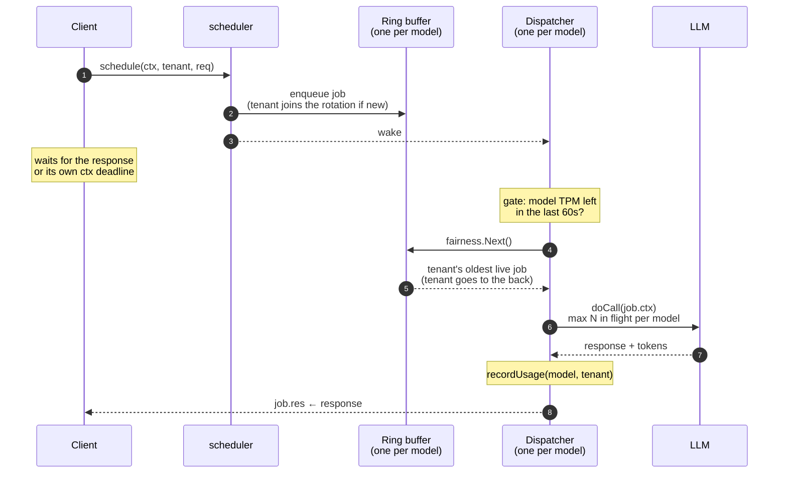

# Intent


### How do you ensure LLM usage fairness across multi tenants and prevent noisy neighbors

All LLM providers apply rate limits such as requests per minute(RPM) or tokens per minute(TPM). Providers respond with 429 once any of these are crossed.
Imagine deploying a LLM feature in your multi tenant enterprise application, and your big customers(tenants) starve out your smaller
customers by hording majority of RPM/TPM.

This was a piece of discussion in my previous employment which can be summed up quite well as above. <br>
I left before I got around to solve it, although i had pieces of it already in place , as to how I would go about solving it.
This is my code which solves it the way i would have.

<br>
The major parts in the codebase are :

1. A bounded ring buffer per model . Bounded buffer contains tenant->(multiple llm jobs as in requests)
2. A scheduler runs with dictated fairness policy. Taking eg of simpler policy say round robin.
3. Incoming llm requests are sent to scheduler, which enqueues the requests per tenant in above bounded queue.
4. Since the fairness policy is round robin, we pop from the bounded buffer, send to llm. If jobs are remaining for tenant, we push to back.
5. One by one queue keeps getting enqueued/dequed where each tenant sends requests to LLM in a round robin fashion.
6. If you had dictated another policy, say least served, while selecting an tenant off the bounded queue, we chceck to see, over current usage which tenant has had the least chance to get to llm.

---
## How it works


---

What the benchmark results show for the two different policy ( by the way i had claude write the entire scheduler_test.go)

- The benchmark mimics llm calls with randomized latency and tokens as usage. We set parallelism to 64 on my M1 Mac. (~640 clients)
- We use a made up tenant such as pebbleapp and overload the haiku model.
- P99 latency for both policies is ~65ms.
- We get close to ~1600 requests per minute served. 
- Now ofcourse the benchmark is sustained load of heavy traffic, 640 concurrent clients, each sending its next request as soon as the previous one finishes. 
- And we use a fake llm which is super fast returning in ~10ms , which would be much higher in real prod.


Least Served
```
go test -run xxx -bench 'Scheduler/leastserved/noisy=true' -benchtime 4m -timeout 30m

pprof on :1122/debug/pprof/
goos: darwin
goarch: arm64
pkg: github.com/somak2kai/turnstile
cpu: Apple M1 Pro
BenchmarkScheduler/leastserved/noisy=true-10             5984175             48088 ns/op                59.90 p99-ms            64.55 served%         1611 served/min
PASS
ok      github.com/somak2kai/turnstile  337.366s

```

Round Robin

```
go test -run xxx -bench 'Scheduler/roundrobin/noisy=true' -benchtime 4m -timeout 30m 

pprof on :1122/debug/pprof/
goos: darwin
goarch: arm64
pkg: github.com/somak2kai/turnstile
cpu: Apple M1 Pro
BenchmarkScheduler/roundrobin/noisy=true-10              5991843             48089 ns/op                59.90 p99-ms            64.55 served%         1611 served/min
PASS
ok      github.com/somak2kai/turnstile  337.693s

```